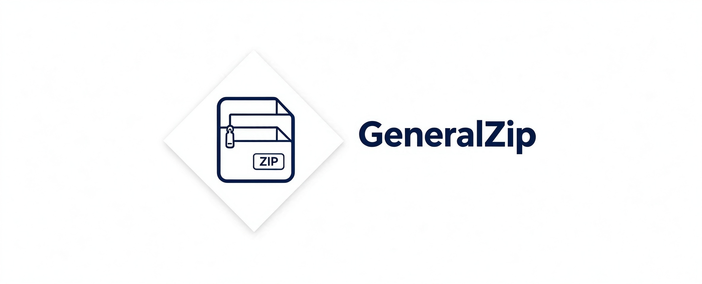

<div align="center">



# GeneralZip

**A cross-format, encryption-capable (SM4/Guomi included), event-driven compression library for .NET**

[](https://github.com/GeneralLibrary/GeneralZip/actions/workflows/ci.yml)
[](https://github.com/GeneralLibrary/GeneralZip/actions/workflows/release.yml)
[](LICENSE)
[](https://learn.microsoft.com/dotnet/standard/net-standard)

[**English**](README.md) | [中文](README.zh-CN.md)

</div>

---

## Why GeneralZip?

- **One API, many formats** — ZIP, 7z, RAR, TAR, GZ, BZ2, XZ, Zstd, LZ4, Brotli, CPIO, ISO9660 (read) and CAB (read) with automatic magic-byte detection. No more "which library do I need for this file?"
- **Encryption done right** — WinZip AES for universal interop, **SM4-GM** (Chinese national cryptography) as a documented custom ZIP extension, and an **SM2-GM envelope** (per-entry data keys sealed with SM2 public-key encryption — public-key recipients, no shared passwords). All behind one `EncryptionAlgorithm` switch, with a pluggable KDF registry.
- **Built for apps, not just scripts** — full event system (progress, interactive password prompts, overwrite decisions, error policies), `CancellationToken` everywhere, `IProgress<T>` support, parallel compress/extract, `IAsyncEnumerable` entry enumeration.
- **Zero third-party NuGet dependencies in the core** — cryptographic primitives (SM3/SM4/SM2) and the TAR/CPIO containers are pure C# implementations validated against GB/T standard test vectors; native codecs (7z/bzip2/xz/zstd/lz4/brotli) live in an optional Rust native core, all pure Rust, streamed with zero temp files.

## Installation

```
dotnet add package GeneralZip
```

Targets `netstandard2.0` and `net8.0`.

> One package, everything included. The library bundles prebuilt Rust native cores for
> win-x64, linux-x64, linux-musl-x64, osx-x64 and osx-arm64; they are detected and loaded
> automatically on first use — no initialization call needed. If the core is missing for
> your platform, 7z/RAR and the native codecs degrade gracefully; everything else keeps
> working.

## Quick Start

### Compress / extract in one line

```csharp
using GeneralZip;

// Directory → archive (format is chosen by the file extension)
await GeneralZip.CompressAsync(@"C:\data", @"D:\backup.zip");

// Archive → directory
var result = await GeneralZip.ExtractAsync(@"D:\backup.zip", @"D:\restore");
Console.WriteLine($"Extracted {result.ProcessedCount} entries, {result.FailedCount} failed");
```

### Encrypted archives

```csharp
using GeneralZip;
using GeneralZip.Abstractions;

// Write: SM4-GM (Chinese national crypto) — see docs/CRYPTO-SPEC.md
await GeneralZip.CompressAsync(@"C:\data", @"D:\backup.zip", o =>
{
    o.Level = CompressionLevelChoice.Optimal;
    o.EncryptionAlgorithm = "SM4-GM";          // or "WinZipAES256" for universal interop
    o.Password = password;                     // get it from your secret store, never hard-code
    o.KdfIterations = 10_000;                  // SM3-PBKDF2 rounds
});

// Read: wrong passwords fail fast (per-entry verifier), no silent corruption
using var reader = GeneralZipReader.Open(@"D:\backup.zip", o => o.Password = password);
var entry = reader.Entries[0];
using var stream = reader.OpenEntryStream(entry);   // lazy decrypt + decompress stream
```

### Streaming API with events

```csharp
using GeneralZip;
using GeneralZip.Abstractions;

// Create an archive with progress reporting
using var writer = GeneralZipWriter.CreateNew(@"D:\photos.zip", o =>
{
    o.Level = CompressionLevelChoice.SmallestSize;
    o.Progress = new Progress<ArchiveProgress>(p =>
        Console.Write($"\r{p.Percent:F0}% {p.CurrentEntry}"));
});
writer.AddFile(@"C:\a.pdf", "docs/a.pdf");
await writer.AddDirectoryAsync(@"C:\photos", "photos");
await writer.FinishAsync();     // auto-finalized on Dispose too
```

```csharp
// Extract with interactive password, overwrite and error handling
using var reader = GeneralZipReader.Open(archivePath, configure: null, r =>
{
    // For whole-archive formats (e.g. 7z header encryption) subscribe here —
    // the password may be needed during Open itself.
    r.PasswordRequired += (_, e) =>
    {
        e.Password = PromptPassword(e.EntryName, e.Attempt);   // your UI logic
        if (e.Attempt >= 3) e.Cancel = true;                   // give up after 3 tries
    };
    r.OverallProgress += (_, p) => UpdateProgressBar(p.Percent, p.Eta);
});

var result = reader.ExtractToDirectory(@"D:\out", new ExtractionOptions
{
    OverwritePolicy = OverwritePolicy.Ask,      // raises reader.OverwriteQuery
    ErrorPolicy = ErrorPolicy.RaiseEvent,       // raises reader.ErrorReport (retry/skip/abort)
    Filter = e => e.FullName.EndsWith(".pdf", StringComparison.OrdinalIgnoreCase),
});
```

### High-level operations

```csharp
// Append to an existing archive (read→rewrite; encrypted archives keep their algorithm)
await GeneralZip.AppendAsync("backup.zip", @"C:\new-files");

// Remove entries by exact name
await GeneralZip.RemoveAsync("backup.zip", new[] { "junk.txt" });

// Cross-format conversion (target format from extension)
await GeneralZip.ConvertAsync("old.zip", "new.7z");

// Stream → archive stream and back (no disk involved)
await GeneralZip.CompressAsync(sourceStream, output, "ZIP", "data.bin");

// Parallel extraction & compression (entry-level sharding)
GeneralZip.Extract("huge.zip", "out", extraction: new ExtractionOptions { MaxDegreeOfParallelism = 4 });

// Glob include/exclude filters
GeneralZip.Extract("logs.zip", "out", extraction: new ExtractionOptions
{
    IncludePatterns = new[] { "**/*.log" },
    ExcludePatterns = new[] { "**/*.tmp" },
});

// Symbolic links & Unix permissions (ZIP/TAR)
writer.AddSymlink("latest.log", "logs/2026.log");
GeneralZip.Extract("pkg.tar", "out", extraction: new ExtractionOptions
{
    SymlinkPolicy = SymlinkPolicy.Preserve,
    PreserveUnixAttributes = true,
});
```

### Integrity testing

```csharp
// Works without a password for plain archives; supply one for encrypted archives
using var testReader = GeneralZipReader.Open(path, o => o.Password = password);
var test = testReader.TestAll();
Console.WriteLine(test.Success ? "OK" : $"{test.FailedCount} entries failed");
```

### Format detection & extensibility

```csharp
var info = GeneralZip.DetectFormat(mysteryFile);    // magic bytes first, extension fallback
Console.WriteLine(info?.Name);                      // "ZIP", "7Z", "TAR.GZ", ...

// Register a custom format or encryption algorithm
GeneralZip.Registry.Register(new MyArchiveFormat());
GeneralZip.Encryption.Register(new MyEncryptionProvider());
```

## Format & Encryption Matrix

| Format | Read | Write | Encrypted Read | Encrypted Write |
|---|:---:|:---:|:---:|:---:|
| ZIP (Store/Deflate/**BZip2/Zstd/LZMA**/Zip64) | ✓ | ✓ | ZipCrypto / WinZip AES / **SM4-GM** / **SM2-GM** | ✓ |
| 7z (LZMA2) | ✓ | ✓ | AES-256 | AES-256 |
| RAR4/RAR5 | ✓ | — (proprietary) | ✓ password | — |
| TAR / TAR.GZ / TAR.BZ2 | ✓ | ✓ | — | — |
| GZ | ✓ (.NET built-in) | ✓ (.NET built-in) | — | — |
| BZ2 / XZ / ZSTD / LZ4 / BROTLI | ✓ (native core) | ✓ (native core) | — | — |
| CPIO (newc/odc/binary) | ✓ | ✓ (newc) | — | — |
| ISO9660 (+Joliet/Rock Ridge) | ✓ | — (read-only) | — | — |
| CAB | ✓ (NONE/stored) | — (read-only) | — | — |

> 7z/RAR and BZ2/XZ/ZSTD/LZ4/BROTLI are provided by the **Rust native core** (all pure-Rust crates),
> streamed through a callback FFI with no temp files. When the core is missing, the library degrades
> gracefully: ZIP/TAR/CPIO/GZ (pure managed) and all ZIP-family encryption are unaffected.
> ZIP entries can use BZip2/Zstd/LZMA compression methods (interop with 7-Zip/Info-ZIP archives).

**Why some cells are "—":**

- **RAR write** — the RAR compression algorithm is proprietary; the published unrar license
  explicitly forbids reimplementing the compressor, and WinRAR is the only tool that can
  produce RAR archives (the same reason 7-Zip, libarchive, etc. are read-only). Reading,
  including password-protected archives, is fully supported via the native core.
- **Encryption columns for TAR / GZ / BZ2 / XZ / ZSTD / LZ4** — these format specifications
  contain no encryption mechanism at all: TAR is a plain header + data container, and the
  single-file codecs have nowhere to carry KDF parameters, IVs, or authentication tags.
  Encrypt at the application layer (encrypt-then-compress), or use ZIP with WinZip AES / SM4-GM.
- **SM4-GM is ZIP-only by design** — ZIP's extra-field mechanism is officially extensible,
  so the SM4-GM container is fully documented in [docs/CRYPTO-SPEC.md](docs/CRYPTO-SPEC.md)
  for third-party interop. Injecting custom crypto into standardized containers such as 7z
  would produce archives no other tool can open.
- **ZipCrypto write is disabled by default** (legacy 56-bit cipher); it must be opted into
  explicitly. Prefer WinZip AES (universal) or SM4-GM (national cryptography compliance).

## Building from Source

```powershell
.\build\build.ps1              # Rust native core + managed build + all tests
.\build\build.ps1 -SkipNative  # managed only (7z/RAR and the native codecs unavailable)
```

Prerequisites:
- .NET SDK 8.0+
- Rust (native core only) — GNU toolchain on Windows:
  ```powershell
  rustup-init.exe -y --default-toolchain stable-x86_64-pc-windows-gnu --profile minimal
  ```
- RAR support (`rar` cargo feature): additionally requires MSVC; off by default

### Deploying the native core manually

Place `generalzip_native.dll/.so/.dylib` in one of:
1. the application directory,
2. `runtimes/<RID>/native/` under the app directory,
3. any path referenced by the `GENERALZIP_NATIVE` environment variable,

The core is picked up automatically the first time you use the library — no
initialization call is needed.

## Sample Files

[samples/fixtures/](samples/fixtures/README.md) ships sample archives for **every supported format**
(10 plaintext + 4 encrypted variants) with the public demo password and plaintext SHA-256 checksums.
These are also cross-version compatibility anchors verified by the test suite.

## Benchmarks

Throughput numbers for all formats (including per-algorithm encryption overhead), measured by
[samples/GeneralZip.Bench](samples/GeneralZip.Bench/Program.cs): [docs/BENCHMARKS.md](docs/BENCHMARKS.md).

## Documentation

| Document | Content |
|---|---|
| [docs/ARCHITECTURE.md](docs/ARCHITECTURE.md) | Layered architecture, interface contracts, event protocol, Rust FFI design (Chinese) |
| [docs/CRYPTO-SPEC.md](docs/CRYPTO-SPEC.md) | Binary spec of the SM4-GM encrypted ZIP container for third-party interop (Chinese) |
| [docs/BENCHMARKS.md](docs/BENCHMARKS.md) | Full-format performance data (Chinese) |
| [samples/](samples/) | Runnable samples: basic usage, events, benchmarks, fixture generator |
| [fuzz/](fuzz/) | Read-path fuzzing harness (SharpFuzz) + CI robustness regression |

## Project Layout

```
src/GeneralZip/           Library (managed core + bundled Rust native core bindings)
src/GeneralZip.Cli/       gz command line (dotnet tool: `dotnet tool install GeneralZip.Cli`)
native/generalzip-native/ Rust cdylib: 7z/bzip2/xz/zstd/lz4/brotli codecs (C ABI, streaming)
native/dlltool-shim-rs/   Build helper for windows-gnu raw-dylib imports
tests/                    158 tests: standard vectors, interop oracle, events, fixtures, robustness
samples/                  Samples + sample archives (fixtures + third-party interop anchors)
fuzz/                     Read-path fuzzing harness (SharpFuzz)
build/                    One-shot build script
```

## Known Limitations

- RAR is **read-only** — the compression algorithm is proprietary; no compliant implementation can create RAR archives.
- 7z archives cannot be appended in place; Append/Convert use read→rewrite semantics (producing a whole new archive).
- SM4-GM / SM2-GM are custom specifications (ZIP has no official SM standards); interop is limited to this library and third parties implementing the same specs (see `docs/CRYPTO-SPEC.md`).
- BZ2/XZ/ZSTD/LZ4/BROTLI require the native core; GZip is always available (pure managed).
- ISO9660 and CAB are read-only. CAB supports NONE (stored) folders only — MSZIP/LZX/Quantum require a proprietary 32K-window decoder.
- Append/Remove/Convert rewrite the archive: original entry encryption parameters (salt/IV) are regenerated, but the algorithm is preserved automatically.

## Contributing & License

Issues and PRs are welcome. Please run `build\build.ps1` and make sure all tests pass before submitting.

Released under the [MIT License](LICENSE).

<div align="right">

[**English**](README.md) | [中文](README.zh-CN.md)

</div>
